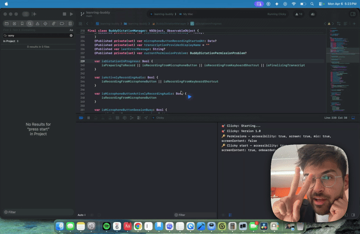

## The Lyceum

The Lyceum is this repo turned into a rehearsal coach. Same engine, same hotkey, one new idea: **tap** the hotkey instead of holding it, and the app watches your screen and listens to you present, then grades the run.

Tap `Control + Option` to start a run — only if a slide tool is in front of you. Talk through your deck like you would in the room — slides change are detected automatically. Tap it again to stop. A few seconds later you get a verdict: scores, what landed, where it broke, and per-slide edits you can copy straight back into Keynote or PowerPoint. Export the whole thing as Markdown or JSON.

Four drills, picked in the panel:

- **Feynman** — teach a concept out loud. It flags the jargon you used without defining, the mechanism you hand-waved past, and the exact step where your chain breaks.
- **Defence** — present a project to a panel that has to score it. It judges the claim against what was actually measured, names the method step a judge would ask about first, and scores Question, Method, Evidence, Understanding, Delivery.
- **Debate** — argue a position under time pressure. It reconstructs your case, lists the objections you never answered, and scores structure, evidence, delivery and rebuttal.
- **Slide review** — present the deck. It reads density, checks whether what you *said* matches what's *on* the slide, and rewrites bullets plus speaker notes for each one.

Holding `Control + Option` still does the original thing: push-to-talk, screenshot, question, answer. Nothing was taken away.

### It asks five questions first

A fresh install does not open a panel. It opens the dashboard and asks: **which year are you in**,
**who are you presenting to** (teachers, classmates, a judging panel, parents, a club, a public
audience, or something you type yourself), **is this a competition**, and if so **what it is called**.
Then it shows the five seats already filled and lets you keep them or brief your own.

The answers are not decoration. The year group sets the vocabulary ceiling and how hard anyone is
allowed to push; the audience changes which seats exist — say you are presenting to parents and the
classmate becomes a parent who works outside your field; a competition turns every dial one step
harsher and makes the timekeeper a contest timekeeper. That single line goes into the grading prompt
and into the room's prompt, and you can read it back verbatim in **Settings → Getting started**, so
you always know what the model was told about you. Nothing leaves the Mac about you: the analytics
event carries a bucket (`k12` / `university` / `other`), how many audiences you ticked, whether it is
a competition, and how many seats you customised. Never your school, never the competition's name.

Answers live under the `lyceumLearnerProfile` default, and the questionnaire can be run again from
**Settings → Getting started**.
### It knows when you finished

You do not have to tap again. A run ends by itself when the talk does: a goodbye / "any questions?" slide appears, or you say the closing words — "cảm ơn mọi người đã lắng nghe", "thank you for listening", "私の発表は以上です", whichever language you presented in — and the room then goes quiet for three seconds. The pause is required, because a speaker who says "thanks" and keeps going was not finished. Switch it off with **End the run when the talk ends**.

### Then the room asks questions

A verdict on its own is a report card. The Lyceum finishes the session the way a real room does: five people who watched and heard the whole thing turn around and ask you about it.

The room is drawn like a call — participant tiles, a permanent control bar, a room code in the corner, your own feed floating at the edge — because everyone already knows what a call looks like when somebody is about to speak. Each tile is a separate agent with its own name, role and voice, and they are not interchangeable:

| Who | What they care about |
|---|---|
| **Mara Vidal** — committee chair | whether the claim was actually justified |
| **Tom Reyes** — product lead | what breaks in week one |
| **Ines Okafor** — domain expert | the number you skipped, the term you used wrongly |
| **Kenji Sato** — funder | why now, how big, what they would have to believe |
| **Priya Nair** — session chair | the promise, whether it got paid off, what to do next |

They ask out loud, one at a time, **in the language you presented in**. When a question lands, hold `Control + Option` and answer the way you would at the podium; release when you are done. The agent who asked decides honestly whether the answer held up: if it did, they sit down; if you dodged, you get one follow-up. A quick tap passes on the question, and a quiet room moves on by itself after 45 seconds. Mute the room, or turn captions off, from its control bar.

When the round ends there is a second number: how the talk **defended**, judged on directness, evidence produced on demand, and whether you conceded instead of bluffing — fluency alone does not earn it. It is merged into the same report, so the Markdown export carries both halves of the rehearsal.

The People button opens the **agent studio**: five seats, and for each one a name, an icon, a role,
a tone (Gentle, Standard, Brutal) and up to **five criteria**, chosen from three groups — what the
agent *does* (asks questions, critiques, fact-checks, suggests slide edits, checks clarity, keeps
time, encourages, plays devil's advocate), how it *behaves* (curious, blunt, patient, skeptical,
warm, strict, playful, formal) and what it *watches* (evidence, structure, mechanism, plain language,
why it matters, slides and visuals, delivery, originality). Five is a hard ceiling: the sixth chip
greys out instead of vanishing, and the card at the bottom shows the exact sentence the agent will be
given, so the trade is visible before you make it. A seat you have briefed yourself is never
overwritten by the questionnaire. Any agent can be given an ElevenLabs voice id; with none set, every
agent gets a different local macOS voice, so a fresh install already sounds like five people.

### It measures the voice, and can see the room

Before any model is asked anything, the app does arithmetic on the microphone it was already holding: words per minute, how much of the run was silence and where the longest pause was, how far the loudness moved and how much the pitch moved, and which filler words came back — in the language you spoke, so a Vietnamese "kiểu là" is never merged with an English "kind of". Those numbers go into the grading prompt, so the model can be held to them instead of noticing your pace in a general way. Turn it off in the panel if you would rather not see the figures; it costs nothing to leave on, because no extra audio is captured.

Optionally, and off by default, **stills from the camera**: one small frame every 12 seconds (you set the interval), shrunk to 512 pixels, sent to the model together with your slides so it can say something about facing, hands, posture and where your eyes were when the important sentence arrived. They are not video. They are never written to disk, never attached to a saved session, and dropped the moment grading finishes; an abandoned run keeps nothing. It is asked for once, in System Settings, and the dashboard explains it in those words.

### A dashboard for a term of practice

The coach panel answers "how did that run go". The dashboard answers the question a student actually has before a competition: *am I getting better*. Score per run over the term, runs per day for the last three weeks, averages per drill, a streak, and the words that keep coming back across every "where it broke down" and "you never answered this" line, counted instead of remembered. Every saved run is on one shelf, openable, copyable, deletable. All of it is arithmetic over the reports already on disk — no model call, so the chart cannot change its wording or its mind between visits.

It opens from the square icon in the menu bar panel or **Dashboard** in the coach panel footer, and it is the only real window in the app: titled, closable, keyboard-focusable, and it borrows the Dock icon while it is open because a menu-bar app does not normally have one.

Everything that is *configuration* rather than *practice* now sits behind **one gear at the foot of
the sidebar** — voice and camera, the room, the rules, data, appearance, getting started. The three
tabs those used to be are gone, because they were never things you practise. **Data** counts the runs
on disk, opens the folder, exports every saved run as one JSON file, and deletes runs older than 30 or
90 days after asking inline (the run you are looking at stays). **Appearance** pins the app to light,
dark or the system, and it applies to the panels, the coach card and the sheets as well, which used to
be frozen in dark; motion can be dialled down there too.

### It only starts in a slide tool

The hotkey refuses to open a run unless a presentation is in front of you: Keynote, PowerPoint, Google Slides, Canva, Gamma, Pitch, Prezi or LibreOffice Impress. That is the point — this is a rehearsal room, not a general-purpose assistant.

A Canva poster does not count. Web tools are recognised from the browser tab's title (which needs the Screen Recording permission the slide watcher already asks for), so "Quarterly review – Canva" opens a room while "Event poster – Canva" does not, and the same goes for whiteboards, one-pagers, thumbnails and invitations. Native apps are matched by bundle id and are exact.

If the tool you actually present in is not on the list, the coach panel says so, names the window it looked at, and offers **Allow this app**. The requirement can be switched off entirely in the same place.

---

Built on [Clicky](https://github.com/farzaa/clicky) by [@farzatv](https://x.com/FarzaTV), MIT licensed. The product name changed; the original code, license and author notes below stay exactly as they were.

---

## Get HeyClicky for Mac and Windows

The official app is **[HeyClicky](https://www.heyclicky.com/)**, an AI buddy for Mac and Windows, made by me and the team.

- **Mac:** [download HeyClicky for Mac](https://www.heyclicky.com/for-mac) (macOS 14.2 or later)
- **Windows:** [download HeyClicky for Windows](https://www.heyclicky.com/for-windows) (Windows 10 and 11)

Those are the only official downloads. Other Windows apps built from this repo are community ports, not made by us.

---

Update: April 27, 2026.

Hi there! I'm Farza, the guy that made Clicky.

The existing codebase remains open source. Tinker with it, make it yours, start a company out of it, do whatever you want I don't mind. But, for all the new stuff I'm hacking on, gonna keep it private. To get the latest version, HeyClicky for Mac or Windows, go to [heyclicky.com](https://www.heyclicky.com/).

I also tweeted about this [here](https://x.com/FarzaTV/status/2043402737828962489).

Go crazy with this repo!! It's an MIT license.

# Hi, this is Clicky.
It's an AI teacher that lives as a buddy next to your cursor. It can see your screen, talk to you, and even point at stuff. Kinda like having a real teacher next to you.

Download HeyClicky for free for [Mac](https://www.heyclicky.com/for-mac) or [Windows](https://www.heyclicky.com/for-windows).

Here's the [original tweet](https://x.com/FarzaTV/status/2041314633978659092) that kinda blew up for a demo for more context.



This is the open-source version of Clicky for those that want to hack on it, build their own features, or just see how it works under the hood.

## Get started with Claude Code

The fastest way to get this running is with [Claude Code](https://docs.anthropic.com/en/docs/claude-code).

Once you get Claude running, paste this:

```
Hi Claude.

Clone https://github.com/farzaa/clicky.git into my current directory.

Then read the CLAUDE.md. I want to get Clicky running locally on my Mac.

Help me set up everything — the Cloudflare Worker with my own API keys, the proxy URLs, and getting it building in Xcode. Walk me through it.
```

That's it. It'll clone the repo, read the docs, and walk you through the whole setup. Once you're running you can just keep talking to it — build features, fix bugs, whatever. Go crazy.

## Release configuration

The release metadata is intentionally defined in one place and mirrored into the landing page:

- `Config/Release.xcconfig` defines `MARKETING_VERSION`, `CURRENT_PROJECT_VERSION`, and `MACOSX_DEPLOYMENT_TARGET`.
- `scripts/version.sh` prints the same values for automation and docs.
- `landing/download-config.json` is the single source of truth for the public download channel metadata.
- `scripts/check-release-config.sh` fails if the project version, minimum macOS, appcast repo, or product name drift away from the public configuration.

## Manual setup

If you want to do it yourself, here's the deal.

### Prerequisites

- macOS 14.2+ (for ScreenCaptureKit)
- Xcode 15+
- Node.js 18+ (for the Cloudflare Worker)
- A [Cloudflare](https://cloudflare.com) account (free tier works)
- API keys for: [Anthropic](https://console.anthropic.com), [AssemblyAI](https://www.assemblyai.com), [ElevenLabs](https://elevenlabs.io)

### 1. Set up the Cloudflare Worker

The Worker is a tiny proxy that holds your API keys. The app talks to the Worker, the Worker talks to the APIs. This way your keys never ship in the app binary.

```bash
cd worker
npm install
```

Now add your secrets. Wrangler will prompt you to paste each one:

```bash
npx wrangler secret put ANTHROPIC_API_KEY
npx wrangler secret put ASSEMBLYAI_API_KEY
npx wrangler secret put ELEVENLABS_API_KEY
```

For the ElevenLabs voice ID, open `wrangler.toml` and set it there (it's not sensitive):

```toml
[vars]
ELEVENLABS_VOICE_ID = "your-voice-id-here"
```

Deploy it:

```bash
npx wrangler deploy
```

It'll give you a URL like `https://your-worker-name.your-subdomain.workers.dev`. Copy that.

### 2. Run the Worker locally (for development)

If you want to test changes to the Worker without deploying:

```bash
cd worker
npx wrangler dev
```

This starts a local server (usually `http://localhost:8787`) that behaves exactly like the deployed Worker. You'll need to create a `.dev.vars` file in the `worker/` directory with your keys:

```
ANTHROPIC_API_KEY=sk-ant-...
ASSEMBLYAI_API_KEY=...
ELEVENLABS_API_KEY=...
ELEVENLABS_VOICE_ID=...
```

Then update the proxy URLs in the Swift code to point to `http://localhost:8787` instead of the deployed Worker URL while developing. Grep for `clicky-proxy` to find them all.

### 3. Update the proxy URLs in the app

The app has the Worker URL hardcoded in a few places. Search for `your-worker-name.your-subdomain.workers.dev` and replace it with your Worker URL:

```bash
grep -r "clicky-proxy" leanring-buddy/
```

You'll find it in:
- `CompanionManager.swift` — Claude chat + ElevenLabs TTS
- `AssemblyAIStreamingTranscriptionProvider.swift` — AssemblyAI token endpoint

### 4. Open in Xcode and run

```bash
open leanring-buddy.xcodeproj
```

In Xcode:
1. Select the `leanring-buddy` scheme (yes, the typo is intentional, long story)
2. Set your signing team under Signing & Capabilities
3. Hit **Cmd + R** to build and run

The app will appear in your menu bar (not the dock). Click the icon to open the panel, grant the permissions it asks for, and you're good. The product is `Lyceum.app` but it keeps the original bundle id `com.yourcompany.leanring-buddy` — deliberately, because changing it would silently reset every TCC permission you already granted.

### Permissions the app needs

- **Microphone** — push-to-talk, plus continuous capture while a practice run is live
- **Accessibility** — for the global keyboard shortcut (Control + Option: tap = start or stop a run, hold = ask, hold while the room is waiting = answer)
- **Screen Recording** — screenshots on the hotkey, plus a 1.6s slide-change watcher while a run is live
- **Screen Content** — for ScreenCaptureKit access
- **Camera** — only if you switch "Stills from the camera" on. One small still every few seconds, sent with the slides, never stored. Nothing about it runs unless you turn it on.

The slide watcher only stores a snapshot when the screen actually settles on something new, so a 10-minute run costs a handful of images, not 400.

The audience panel needs nothing extra. It reads the same microphone and the same screen-recording grant, and its voices come from macOS itself unless you give an agent an ElevenLabs voice id. The voice measurement needs nothing either — it works on buffers the run already had in memory.

## Architecture

If you want the full technical breakdown, read `CLAUDE.md`. But here's the short version:

**Menu bar app** (no dock icon) with three `NSPanel` windows — the control panel dropdown, the full-screen transparent cursor overlay, and the Lyceum coach panel that parks bottom-right while you present. Push-to-talk streams audio over a websocket to AssemblyAI, sends the transcript + screenshot to Claude via streaming SSE, and plays the response through ElevenLabs TTS. Claude can embed `[POINT:x,y:label:screenN]` tags in its responses to make the cursor fly to specific UI elements across multiple monitors. All three APIs are proxied through a Cloudflare Worker.

The coaching path reuses the same pieces with different plumbing. `LyceumSessionRecorder` owns a second `AVAudioEngine` for the long run and rotates the AssemblyAI session every five minutes, because a temporary streaming token dies at 480 seconds — the transcript from each segment is stitched into one text. `LyceumSlideWatcher` squashes each frame to a 12x8 luminance grid and commits a slide when that grid stays different for two polls, so the menu bar clock and hover states do not count as slides. At stop, the transcript plus up to 12 of the slides that held the most screen time go into one Claude call with a JSON output contract; the verdict is parsed into `LyceumCoachReport`, saved under `Application Support/The Lyceum/Sessions`, and the two-sentence `spokenFeedback` is read aloud.

The measured delivery is deliberately not a model opinion: `LyceumDeliveryMeter` walks the same PCM buffers the level meter already sees and computes RMS, spectral-flatness for voiced/unvoiced, a zero-crossing pitch proxy, and language-aware filler counts. `LyceumPresenceCamera` is the opt-in half: `AVCapturePhotoOutput` stills on a timer, downscaled through AppKit, held in an array and emptied at the end of the review. `LyceumInsights` then reads the saved sessions and aggregates: trend, day buckets, streak, and a keyword count over the report's gap, jargon and counter lists. The dashboard window is the only `NSWindow` here (everything else is a non-activating `NSPanel`), and it flips the activation policy to `.regular` while open, because this app is `LSUIElement`.

The learner profile is the one thing that reaches every prompt. `LyceumProfileStore.contextLineForModel`
is appended to the grading system prompt (`LyceumCoachManager.profileContextLine()`) and to the room's
(`LyceumAudiencePrompts.panelSystemPrompt`), and `LyceumAudienceTuning.tuned(_:for:)` reshapes the
default five the moment the questionnaire is finished — string arithmetic on the answers, not another
model call, and it skips any seat that already has criteria of its own.

## Project structure

```
leanring-buddy/          # Swift source (yes, the typo stays)
  CompanionManager.swift    # Central state machine, tap vs hold detection
  CompanionPanelView.swift  # Menu bar panel UI
  ClaudeAPI.swift           # Claude streaming client
  ElevenLabsTTSClient.swift # Text-to-speech playback
  OverlayWindow.swift       # Blue cursor overlay
  AssemblyAI*.swift         # Real-time transcription
  BuddyDictation*.swift     # Push-to-talk pipeline
  LyceumCoachModels.swift     # Drills, report model, JSON parser, exporters
  LyceumCoachPrompts.swift  # System prompts for the four drills
  LyceumSessionRecorder.swift # Long-form mic capture with token rotation
  LyceumSlideWatcher.swift  # Slide-change detection while presenting
  LyceumCoachManager.swift  # Runs the session, grades it, saves it
  LyceumCoachPanelView.swift # Coach UI: live run + verdict
  LyceumCoachWindowManager.swift # Floating coach panel
  LyceumDeliveryMeter.swift   # Microphone arithmetic: pace, pauses, pitch, fillers
  LyceumPresenceCamera.swift  # Optional opt-in stills, memory only
  LyceumAudience.swift        # Roster, agent criteria, panel JSON, closing detector, voices
  LyceumOnboarding.swift      # Five first-run questions, learner profile, profile -> roster tuning
  LyceumAgentStudio.swift     # Studio: name, icon, tone and five criteria per agent
  LyceumTheme.swift           # Light / dark / system for the whole app
  LyceumDashboardSettingsView.swift # Everything behind the gear, including data and exports
  LyceumAudienceManager.swift # The Q&A round state machine
  LyceumInsights.swift        # Term-level aggregation over saved runs
  LyceumDashboardView.swift   # The dashboard UI
  LyceumDashboardWindowManager.swift # The one real window
worker/                  # Cloudflare Worker proxy
  src/index.ts              # Three routes: /chat, /tts, /transcribe-token
CLAUDE.md                # Full architecture doc (agents read this)
```

## Landing page

The public marketing page lives at [`../landing/`](../landing/) — plain HTML/CSS/JS, no build step,
published to GitHub Pages by `.github/workflows/pages.yml`.

- Read [`landing/README.md`](../landing/README.md) before editing copy or colours.
- **Download links are configuration, not code:** `landing/download-config.json`.
  A channel with an empty `url` renders as "coming soon" instead of a dead button, which is the
  current state until release assets named `TheLyceum-arm64.dmg`, `TheLyceum-intel.dmg` and
  `TheLyceum-win-x64.exe` exist.
- `bash landing/scripts/check-downloads.sh` prints which channels are live.

## Contributing

PRs welcome. If you're using Claude Code, it already knows the codebase — just tell it what you want to build and point it at `CLAUDE.md`.

Got feedback? DM me on X [@farzatv](https://x.com/farzatv).
